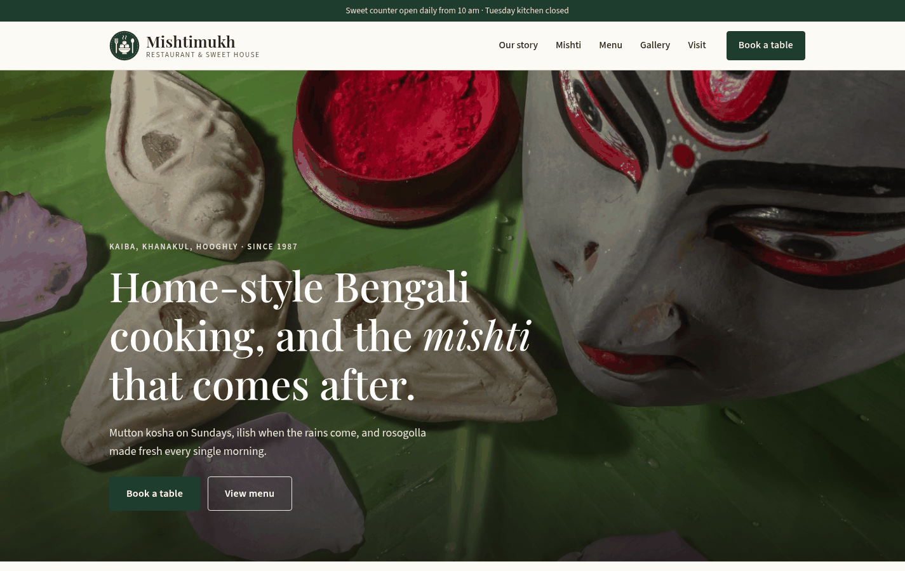

# Mishtimukh — Bengali Restaurant & Sweet House

A responsive website for **Mishtimukh**, a fictional Bengali restaurant and sweet shop in Kaiba, Khanakul (Hooghly, West Bengal).
Built with plain HTML, CSS and JavaScript as a web development project, no frameworks or build tools.

**Live demo:** https://rajatsubharam.github.io/mishtimukh/



## Features

- Sticky header with the Mishtimukh logo (hand-drawn SVG: a bowl of rosogolla between a fork and a spoon) and a hamburger menu on mobile
- SVG favicon with PNG fallbacks
- Full-width hero photo with "Book a table" and "View menu" buttons
- "Our story" section with photos and quick facts
- Mishti (sweets) section with photo cards: rosogolla, sandesh, mishti doi, chomchom, langcha, pantua
- Menu with JavaScript tabs (Starters, Mains, Mishti, Drinks), ₹ prices and veg / non-veg marks
  - Mains: Bengali kitchen (kosha mangsho, chicken kosha, shorshe ilish, egg curry, thalis) plus Chinese & biryani (fried rice, chilli chicken, chilli paneer, chicken manchurian, hakka chowmein, chicken / mutton biryani)
  - Drinks: tea, coffee, cold coffee, lassi, shakes, lemon soda, plus cold drinks and water at MRP
- Photo gallery grid
- Guest reviews (sample text)
- Reservation form with JavaScript validation (name, Indian mobile number, date, Tuesday closed, time, guests) and a success message (no backend, nothing is sent)
- Opening hours table with a live "open now" line based on Kolkata time
- OpenStreetMap of Kaiba, Khanakul (static image first, interactive map on tap)
- Mobile-first layout, tested at 390px and 1440px
- Accessible: semantic HTML, skip link, keyboard-friendly tabs, visible focus states

## Tech used

- HTML5
- CSS3 (Flexbox, Grid, media queries, custom properties)
- Vanilla JavaScript (ES5/ES6, no libraries)
- Fonts bundled locally: Playfair Display and Source Sans 3 (SIL Open Font License)

## Project structure

```
index.html      main page
credits.html    photo credits
style.css       all styles
script.js       nav, menu tabs, form validation, opening status
favicon.svg     site icon (plus favicon-32.png, apple-touch-icon.png)
assets/logo/    Mishtimukh logo (SVG)
assets/img/     photos (resized for the web)
assets/fonts/   web fonts
```

## Run it locally

Just open `index.html` in a browser. No install needed.

To put it on GitHub Pages: push the files to a repository, then go to Settings → Pages and choose the `main` branch.

## Address used on the site

Vill + Post: Kaiba, P.S.: Khanakul, Dist.: Hooghly, West Bengal, PIN 712412

## Disclaimer

Mishtimukh is not a real restaurant. The phone number, email and reviews are placeholders.

## Photo credits

All photos are from Wikimedia Commons and are used under their licences (cropped and resized):

- `about-chomchom.jpg`: "Malai Chomchom from Kolkata, India.jpg" by Ravi Dwivedi, [Wikimedia Commons](https://commons.wikimedia.org/wiki/File:Malai_Chomchom_from_Kolkata,_India.jpg), CC BY-SA 4.0
- `about-counter.jpg`: "Bengali sweets on display.JPG" by Prabirghose, [Wikimedia Commons](https://commons.wikimedia.org/wiki/File:Bengali_sweets_on_display.JPG), CC BY-SA 4.0
- `biryani.jpg`: "Kolkata mutton biryani.jpg" by DeepanjanGhosh, [Wikimedia Commons](https://commons.wikimedia.org/wiki/File:Kolkata_mutton_biryani.jpg), CC BY-SA 4.0
- `chingri-malai.jpg`: "Chingri Macher Malai Curry.jpg" by Riya Chattopadhyay, [Wikimedia Commons](https://commons.wikimedia.org/wiki/File:Chingri_Macher_Malai_Curry.jpg), CC BY-SA 4.0
- `chomchom.jpg`: "Chomchom 2.jpg" by Ferdous, [Wikimedia Commons](https://commons.wikimedia.org/wiki/File:Chomchom_2.jpg), CC BY-SA 3.0
- `doi-pots.jpg`: "Bengalis' favourite - mishti doi.jpg" by Anwesha394, [Wikimedia Commons](https://commons.wikimedia.org/wiki/File:Bengalis%27_favourite_-_mishti_doi.jpg), CC BY-SA 4.0
- `hero.jpg`: "Nolen Gurer Sandesh Kolkata - West Bengal - DSC 0043.jpg" by TAPAS KUMAR HALDER, [Wikimedia Commons](https://commons.wikimedia.org/wiki/File:Nolen_Gurer_Sandesh_Kolkata_-_West_Bengal_-_DSC_0043.jpg), CC BY-SA 4.0 (also cropped as hero-mobile.jpg and og.jpg)
- `ilish-bhapa.jpg`: "Kumro Patay Ilish Vapa.jpg" by Debeshpaul001, [Wikimedia Commons](https://commons.wikimedia.org/wiki/File:Kumro_Patay_Ilish_Vapa.jpg), CC BY-SA 4.0
- `kosha-mangsho.jpg`: "Traditional Bengali Cuisine with Bengali styled cooked Chicken Curry.jpg" by Antik Jana, [Wikimedia Commons](https://commons.wikimedia.org/wiki/File:Traditional_Bengali_Cuisine_with_Bengali_styled_cooked_Chicken_Curry.jpg), CC BY-SA 4.0
- `langcha.jpg`: "Langcha - Godkhali - South 24 Parganas 2016-07-10 4986.JPG" by Biswarup Ganguly, [Wikimedia Commons](https://commons.wikimedia.org/wiki/File:Langcha_-_Godkhali_-_South_24_Parganas_2016-07-10_4986.JPG), CC BY 3.0
- `langcha-tray.jpg`: "Langcha - Saktigarh 2014-06-29 5576.JPG" by Biswarup Ganguly, [Wikimedia Commons](https://commons.wikimedia.org/wiki/File:Langcha_-_Saktigarh_2014-06-29_5576.JPG), CC BY 3.0
- `luchi-alurdom.jpg`: "Alur dom & luchi.jpg" by Rocky Masum, [Wikimedia Commons](https://commons.wikimedia.org/wiki/File:Alur_dom_%26_luchi.jpg), CC BY-SA 4.0
- `mishti-doi.jpg`: "বাংলা মিষ্টি দই.jpg" by Amana Hossain, [Wikimedia Commons](https://commons.wikimedia.org/wiki/File:%E0%A6%AC%E0%A6%BE%E0%A6%82%E0%A6%B2%E0%A6%BE_%E0%A6%AE%E0%A6%BF%E0%A6%B7%E0%A7%8D%E0%A6%9F%E0%A6%BF_%E0%A6%A6%E0%A6%87.jpg), CC BY-SA 4.0
- `nolen-sandesh.jpg`: "Nolen Gur's Sandesh.jpg" by ANKAN, [Wikimedia Commons](https://commons.wikimedia.org/wiki/File:Nolen_Gur%27s_Sandesh.jpg), CC BY-SA 4.0
- `pantua.jpg`: "Pantua of Bengal.jpg" by Riya Chattopadhyay, [Wikimedia Commons](https://commons.wikimedia.org/wiki/File:Pantua_of_Bengal.jpg), CC BY-SA 4.0
- `rasgulla.jpg`: "Rasgulla Sweet.JPG" by Mdsmds0, [Wikimedia Commons](https://commons.wikimedia.org/wiki/File:Rasgulla_Sweet.JPG), CC BY-SA 4.0
- `shorshe-ilish.jpg`: "A photo of popular Bengali dish Sorshe Ilish served traditionally.jpg" by Billjones94, [Wikimedia Commons](https://commons.wikimedia.org/wiki/File:A_photo_of_popular_Bengali_dish_Sorshe_Ilish_served_traditionally.jpg), CC BY-SA 4.0
- `map.jpg`: map data © [OpenStreetMap](https://www.openstreetmap.org/copyright) contributors (ODbL)

The logo is an original SVG made for this project.

---

Designed & developed by Rajat Subhara Mondal
